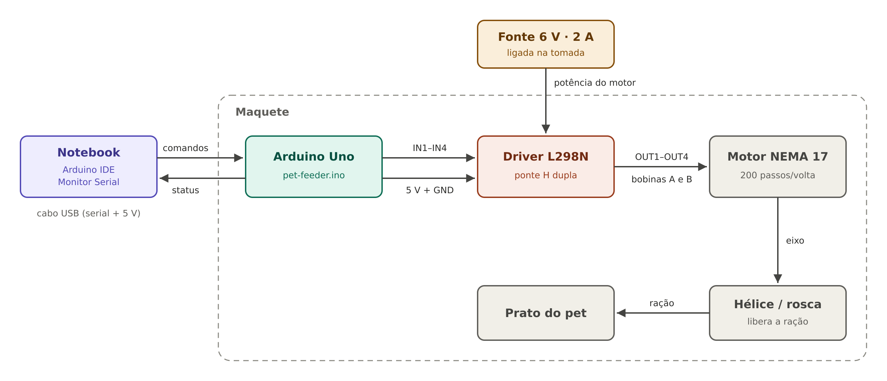
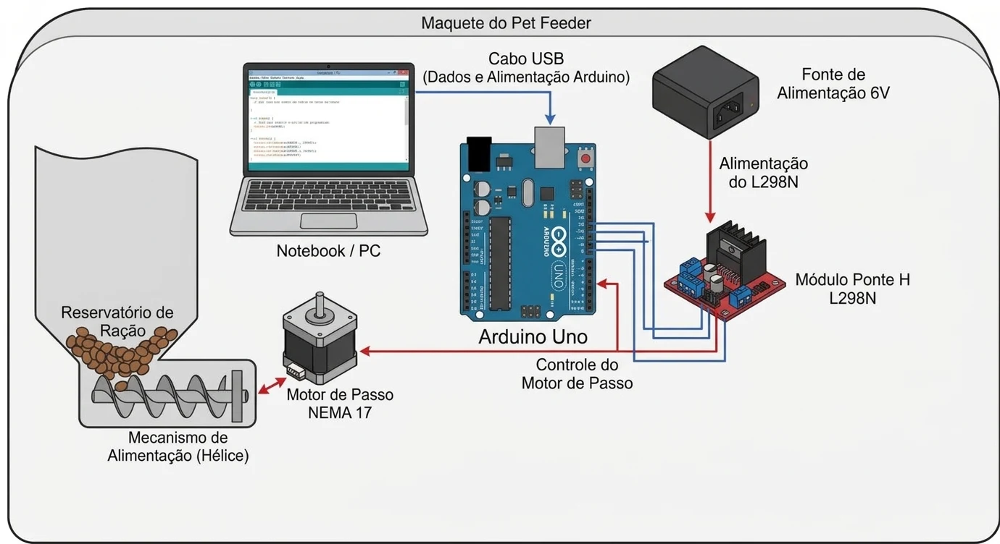
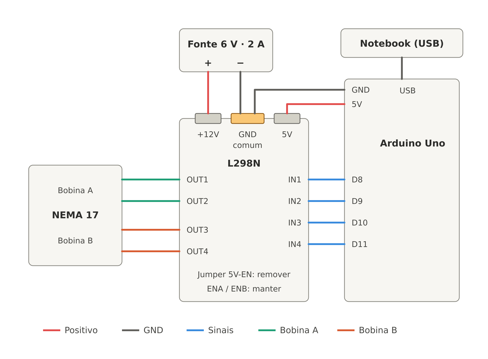

# PetFeeder: Alimentador Pet Automático com Controle Inteligente de Obstrução 🐱

**Alimentador automático de ração com Arduino Uno, motor de passo NEMA 17 e driver L298N.**

## 📝 Resumo

O PetFeeder é um alimentador de ração para animais de estimação. Um motor de passo gira
uma hélice em forma de rosca, instalada na base de um reservatório; a cada volta, a rosca
empurra uma porção de ração para o prato. O sistema funciona sozinho em ciclos (gira,
pausa, repete) e também pode ser controlado pelo teclado do notebook, através do Monitor
Serial da Arduino IDE. Um mecanismo de avanço e recuo evita que grãos irregulares travem
a rosca.

<!--
## 👥 Integrantes
- Nome 1
- Nome 2

## 🎬 Vídeo de demonstração
[Assista no YouTube](https://youtube.com/...)
-->

---

## 📑 Sumário

1. [Descrição do projeto](#1-descrição-do-projeto)
2. [Arquitetura do sistema](#2-arquitetura-do-sistema)
3. [Maquete](#3-maquete)
4. [Componentes](#4-componentes)
5. [Esquemáticos e montagem do circuito](#5-esquemáticos-e-montagem-do-circuito)
6. [Aspectos elétricos](#6-aspectos-elétricos)
7. [Firmware](#7-firmware)
8. [Dependências](#8-dependências)
9. [Como instalar e rodar](#9-como-instalar-e-rodar)
10. [Operação](#10-operação)
11. [Calibração e ajustes](#11-calibração-e-ajustes)
12. [Solução de problemas](#12-solução-de-problemas)
13. [Segurança](#13-segurança)
14. [Possíveis melhorias](#14-possíveis-melhorias)
15. [Estrutura do repositório](#15-estrutura-do-repositório)

---

## 1. Descrição do projeto

### 1.1 Objetivos

- Liberar ração automaticamente, em ciclos de giro e pausa com tempos configuráveis.
- Permitir controle manual pelo teclado do notebook (girar, parar, mudar de modo, inverter
  o sentido).
- Reduzir travamentos causados pela irregularidade dos grãos.
- Manter o projeto simples e fácil de reproduzir: sem rede, sem servidor e sem bibliotecas
  externas.

### 1.2 Funcionamento

O alimentador tem dois modos de operação, que podem ser trocados a qualquer momento pelo
teclado:

- **Automático (padrão):** o motor gira por **10 s**, para por **5 s** e repete
  indefinidamente.
- **Manual:** o motor só gira quando recebe o comando `g`. Cada comando produz um giro com
  a mesma duração do modo automático.

Nos dois modos, o comando `s` interrompe o giro na hora. Durante as pausas, as bobinas do
motor são desligadas, o que evita aquecimento desnecessário do motor e do driver.

### 1.3 Controle de obstrução (anti-travamento)

Grãos de ração têm formatos e tamanhos irregulares e podem se acumular entre a rosca e a
parede do cilindro, bloqueando o giro. Com o anti-travamento ativo (padrão), cada giro é
dividido em fases: o motor **avança por 1 s e recua por 0,3 s**, repetindo até completar o
tempo de giro. O pequeno recuo desfaz o acúmulo e reacomoda os grãos antes do próximo
avanço.

### 1.4 Escopo

Ficam fora desta versão: medição de peso, agendamento por horário real, conectividade sem
fio e interface gráfica (ver [Possíveis melhorias](#14-possíveis-melhorias)).

---

## 2. Arquitetura do sistema



| Bloco | Papel no sistema |
|---|---|
| **Notebook** | Roda a Arduino IDE: grava o firmware e, durante a operação, envia comandos e mostra mensagens de status pelo Monitor Serial. Também fornece 5 V ao Arduino pela USB. |
| **Arduino Uno** | Executa o firmware: interpreta comandos, controla o tempo dos ciclos e gera a sequência de passos nos pinos D8–D11. |
| **Driver L298N** | Ponte H dupla: converte os sinais lógicos do Arduino (poucos mA) na corrente das bobinas do motor (≈1 A). |
| **Fonte 6 V / 2 A** | Fornece a energia do motor. Liga-se apenas ao L298N. |
| **Motor NEMA 17** | Motor de passo bipolar de 200 passos por volta; gira a hélice. |
| **Hélice / rosca** | Mecanismo da maquete que transporta a ração até a saída. |

### 2.1 Dois circuitos de alimentação

O sistema separa a alimentação da lógica da alimentação de potência. Isso protege o
Arduino e a porta USB do notebook, que não suportam a corrente do motor.

| Circuito | Origem | Alimenta | Corrente típica |
|---|---|---|---|
| **Lógica** | USB do notebook (5 V) | Arduino Uno e lógica interna do L298N | ≈ 50–80 mA |
| **Potência** | Fonte 6 V | Bobinas do motor, via L298N | ≈ 1–2 A durante o giro |

Os dois circuitos compartilham o **mesmo GND**. Sem essa referência comum, o L298N não
consegue interpretar os níveis lógicos enviados pelo Arduino ([seção 5.3](#53-gnd-comum)).

### 2.2 Caminho de um comando

O que acontece quando o usuário digita `g` no Monitor Serial:

1. O Monitor Serial envia o caractere `g` pela USB, a 9600 baud.
2. O conversor USB-serial da placa entrega o byte ao microcontrolador ATmega328P.
3. `lerSerial()` lê o caractere e chama `iniciarGiro()`, que muda o estado para GIRANDO.
4. A cada volta do `loop()`, o firmware chama `motor.step()`, que muda o padrão lógico em
   IN1–IN4 para o próximo passo.
5. O L298N reproduz esse padrão nas saídas OUT1–OUT4, energizando as bobinas com a tensão
   da fonte.
6. O rotor avança 1,8° a cada passo; 200 passos completam uma volta da rosca.
7. Ao fim do tempo de giro, `pararGiro()` desliga as bobinas e envia `[MOTOR] Parado.` de
   volta ao Monitor Serial.

---

## 3. Maquete



- **Reservatório:** recipiente vertical onde a ração fica armazenada; alimenta a rosca por
  gravidade.
- **Mecanismo de alimentação (hélice/rosca):** cilindro horizontal na base do reservatório.
  Cada volta transporta um volume aproximadamente constante de ração até a saída.
- **Motor de passo:** acoplado ao eixo da rosca.
- **Prato:** fica sob a saída da rosca.

A eletrônica (Arduino e L298N) fica junto à maquete; a fonte de 6 V vai na tomada e o
Arduino permanece ligado ao notebook pelo cabo USB.

---

## 4. Componentes

| Componente | Função | Especificação / observação |
|---|---|---|
| **Arduino Uno** (ou compatível) | Controle | ATmega328P, 16 MHz, 32 KB flash, 2 KB RAM. Placas compatíveis com chip CH340 funcionam igual. |
| **Motor de passo NEMA 17** | Atuador | Bipolar, 4 fios, 1,8°/passo (200 passos/volta). Ex.: 17HS4401 (≈1,7 A, ≈1,5 Ω por bobina). |
| **Driver L298N** (módulo) | Potência | Ponte H dupla; até 2 A por canal; queda interna de ≈2 V. |
| **Fonte 6 V** | Alimentação do motor | **Mínimo 2 A.** |
| **Cabo USB A-B** | Dados e alimentação do Arduino | Precisa transmitir dados (alguns cabos só carregam). |
| **Jumpers e fios** | Ligações | Fêmea-macho para os pinos IN do L298N. |
| **Maquete** | Estrutura | Reservatório, rosca, suporte do motor e prato. |
| Multímetro (opcional) | Montagem | Ajuda a identificar os pares de fios do motor. |

---

## 5. Esquemáticos e montagem do circuito



### 5.1 Tabelas de ligação

**Arduino → L298N**

| Arduino | L298N | Observação |
|---|---|---|
| D8  | IN1 | Sinal de passo |
| D9  | IN2 | Sinal de passo |
| D10 | IN3 | Sinal de passo |
| D11 | IN4 | Sinal de passo |
| 5V  | 5V (borne) | Alimenta a lógica do L298N — **jumper 5V-EN removido** |
| GND | GND (borne) | GND comum |

**Fonte → L298N**

| Fonte 6 V | L298N | Observação |
|---|---|---|
| + | +12V (VCC/VS) | O borne se chama "12V", mas aceita de 5 a 35 V |
| − | GND (borne) | Mesmo borne do GND do Arduino |

**Motor → L298N**

| Motor | L298N | Observação |
|---|---|---|
| Bobina A, fio 1 | OUT1 | Os dois fios de uma bobina ficam no mesmo borne |
| Bobina A, fio 2 | OUT2 | |
| Bobina B, fio 1 | OUT3 | Borne do lado oposto da placa |
| Bobina B, fio 2 | OUT4 | |

Os jumpers **ENA** e **ENB** do L298N ficam colocados (canais sempre habilitados).

### 5.2 Identificação das bobinas do motor

O NEMA 17 bipolar tem duas bobinas, cada uma com dois fios. Ligar um fio de cada bobina no
mesmo borne é o erro mais comum: o motor só vibra, sem girar.

- **Multímetro:** na escala de resistência (200 Ω), dois fios da mesma bobina medem poucos
  ohms (≈1–5 Ω); fios de bobinas diferentes ficam em aberto ("OL").
- **Teste do eixo:** encoste as pontas de dois fios e gire o eixo à mão. Se ficar mais duro
  de girar, os dois formam um par.
- **Cores:** muitos fabricantes usam preto/verde e vermelho/azul como pares, mas isso não é
  padronizado. Confirme com um dos testes acima.

A ordem dos fios **dentro** de um par só define o sentido de rotação.

### 5.3 GND comum

Tensão é sempre medida em relação a uma referência. Quando o Arduino coloca 5 V em IN1,
esse valor é medido em relação ao GND do Arduino; se o GND do L298N não estiver ligado ao
mesmo ponto, o driver não sabe se o sinal é alto ou baixo.

A união é feita no **borne GND do L298N**: o negativo da fonte e o jumper do GND do
Arduino entram juntos no borne. Se não couberem, faça uma emenda em Y (enrole o jumper na
parte descascada do fio da fonte e isole com fita) ou use um conector de emenda (Wago ou
sindal).

> ⚠️ Não ligue o negativo da fonte a um pino GND do Arduino e o L298N a outro GND do
> Arduino: a corrente de retorno do motor (mais de 1 A) passaria pelas trilhas da placa.

### 5.4 Jumper 5V-EN

O regulador de 5 V do L298N precisa de cerca de 7 V na entrada. Com a fonte de 6 V, ele
entrega só ≈4 V, abaixo do mínimo da lógica do chip (4,5 V). Por isso o jumper 5V-EN é
**removido** e o borne 5V passa a ser **entrada**, alimentada pelo 5V do Arduino.

> ⚠️ **Nunca** ligue o 5V do Arduino ao 5V do L298N com o jumper 5V-EN colocado — são
> duas fontes de 5 V em paralelo.

### 5.5 Ordem de montagem

1. Fonte fora da tomada e Arduino fora da USB durante toda a montagem.
2. Identifique os pares de bobina e ligue o motor em OUT1/OUT2 e OUT3/OUT4.
3. Ligue D8–D11 em IN1–IN4.
4. Remova o jumper 5V-EN e ligue o 5V do Arduino no borne 5V do L298N.
5. Faça o GND comum no borne GND do L298N.
6. Ligue o positivo da fonte no borne +12V.
7. Confira a lista abaixo.
8. Conecte a USB, grave o firmware, abra o Monitor Serial e só então ligue a fonte.

**Antes de energizar:**

- [ ] Polaridade da fonte: + no borne +12V, − no GND.
- [ ] Jumper 5V-EN removido; ENA e ENB colocados.
- [ ] GND da fonte e do Arduino no mesmo borne GND.
- [ ] Cada borne OUT com os dois fios de uma mesma bobina.
- [ ] Nenhum fio desencapado encostando em outro ou no dissipador.

---

## 6. Aspectos elétricos

### 6.1 Queda de tensão no L298N

O L298 usa transistores bipolares, com queda interna de ≈2 V (até 3 V em correntes mais
altas). Com a fonte de 6 V, as bobinas recebem cerca de 3–4 V. Para um NEMA 17 típico
(≈1,5–2,5 Ω por bobina), isso dá correntes próximas da nominal: torque suficiente para a
rosca, mas sem muita sobra. Por isso a velocidade padrão é moderada (60 RPM) e existe o
anti-travamento.

### 6.2 Dimensionamento da fonte

Em passo completo, as duas bobinas ficam energizadas ao mesmo tempo; com ≈1 A em cada, o
consumo chega a 2 A. Uma fonte mais fraca perde tensão sob carga, reduzindo o torque. Use
**6 V com no mínimo 2 A**.

### 6.3 Aquecimento

A queda interna do L298N vira calor: com 1 A por canal e 2 V de queda, são cerca de 4 W
no dissipador. O motor também esquenta enquanto energizado, mesmo parado. Por isso o
firmware desliga as bobinas ao fim de cada giro (`desligarBobinas()`). O motor perde o
torque de retenção na pausa, o que não é problema para uma rosca alimentadora.

### 6.4 Alimentação pela USB

O Arduino fica ligado à USB do notebook durante a operação. A porta entrega até 500 mA,
bem acima do consumo do Arduino somado à lógica do L298N (< 100 mA). O motor nunca deve
ser alimentado pelo Arduino ou pela USB.

---

## 7. Firmware

Arquivo: [`firmware/pet-feeder/pet-feeder.ino`](firmware/pet-feeder/pet-feeder.ino)
(código comentado). Usa apenas a biblioteca `Stepper`, que acompanha a Arduino IDE.

### 7.1 Organização do código

| Parte | Conteúdo |
|---|---|
| Configuração | Constantes de tempo, velocidade e pinos |
| Estado | Variáveis globais: modo, giro, sentido, fases e instantes de início |
| Funções do motor | `iniciarGiro()`, `pararGiro()`, `desligarBobinas()` |
| Comunicação serial | `lerSerial()` (interpreta comandos) e `mostrarAjuda()` |
| `setup()` / `loop()` | Inicialização e máquina de estados |

### 7.2 Parâmetros configuráveis

| Constante | Padrão | Descrição |
|---|---|---|
| `PASSOS_POR_VOLTA` | 200 | Passos por volta do motor (1,8°/passo) |
| `VELOCIDADE_RPM` | 60 | Velocidade; valores maiores reduzem o torque |
| `TEMPO_GIRANDO` | 10000 ms | Duração de cada giro |
| `TEMPO_PARADO` | 5000 ms | Pausa entre giros no modo automático |
| `INICIAR_EM_AUTOMATICO` | `true` | Modo ao ligar |
| `ANTI_TRAVAMENTO_INICIAL` | `true` | Anti-travamento ao ligar |
| `TEMPO_AVANCO` | 1000 ms | Duração de cada avanço |
| `TEMPO_RECUO` | 300 ms | Duração de cada recuo |
| `IN1`–`IN4` | 8, 9, 10, 11 | Pinos ligados ao L298N |

Depois de alterar qualquer valor, grave o código de novo.

### 7.3 Máquina de estados

O controle usa `millis()` (relógio interno em milissegundos) e **nenhum `delay()`**, então
o Arduino continua lendo comandos enquanto o motor gira.

| Estado atual | Evento | Próximo estado / ação |
|---|---|---|
| PARADO | Automático ON e pausa ≥ `TEMPO_PARADO` | GIRANDO (avanço) |
| PARADO | Comando `g` | GIRANDO (avanço) |
| GIRANDO / avanço | Fase ≥ `TEMPO_AVANCO` (anti-travamento ON) | GIRANDO / recuo |
| GIRANDO / recuo | Fase ≥ `TEMPO_RECUO` | GIRANDO / avanço |
| GIRANDO | Giro ≥ `TEMPO_GIRANDO` | PARADO; bobinas desligadas |
| GIRANDO | Comando `s` | PARADO; bobinas desligadas |

As comparações são feitas como `millis() - inicio >= duracao`, forma que continua correta
quando o contador do `millis()` reinicia (a cada ≈49 dias).

### 7.4 Geração dos passos

A biblioteca `Stepper` aciona o motor em **passo completo** com duas fases ligadas:

| Passo | IN1 | IN2 | IN3 | IN4 | Bobina A | Bobina B |
|---|---|---|---|---|---|---|
| 1 | 1 | 0 | 1 | 0 | + | + |
| 2 | 0 | 1 | 1 | 0 | − | + |
| 3 | 0 | 1 | 0 | 1 | − | − |
| 4 | 1 | 0 | 0 | 1 | + | − |

Percorrer a tabela de cima para baixo gira em um sentido; de baixo para cima, no outro.
O `loop()` dá um passo por vez. O intervalo entre passos é:

```
intervalo = 60 / (RPM × passos por volta) = 60 / (60 × 200) = 5 ms
```

### 7.5 Efeito do anti-travamento na quantidade de ração

A 60 RPM (1 volta/s), com os valores padrão:

- cada ciclo dura 1,3 s: 1 volta para frente e 0,3 volta para trás;
- o avanço líquido é de 0,7 volta por ciclo;
- um giro de 10 s tem ≈7,7 ciclos, ou **≈5,4 voltas líquidas** (sem anti-travamento
  seriam 10).

O anti-travamento troca parte da vazão por confiabilidade. O comando `t` liga e desliga o
recurso sem regravar o código, o que facilita comparar.

### 7.6 Uso de memória

Cerca de 4,3 KB dos 32 KB de flash (≈13%) e ≈230 bytes dos 2 KB de RAM (≈11%). As
mensagens usam a macro `F()`, que mantém o texto na flash.

---

## 8. Dependências

### Software

| Dependência | Versão | Observação |
|---|---|---|
| **Arduino IDE** | 2.x | [arduino.cc/en/software](https://www.arduino.cc/en/software) — Windows, macOS ou Linux |
| **Arduino AVR Boards** | já incluso na IDE | Suporte ao Arduino Uno |
| **Biblioteca `Stepper`** | já inclusa na IDE | Controle do motor de passo; **não precisa instalar** |
| **Driver CH340** | — | Apenas para placas compatíveis com chip CH340, no Windows/macOS |

Nenhuma biblioteca externa é necessária.

### Hardware

Arduino Uno (ou compatível), cabo USB A-B, driver L298N, motor NEMA 17, fonte 6 V / 2 A,
jumpers e a maquete (ver [Componentes](#4-componentes)).

---

## 9. Como instalar e rodar

### 9.1 Baixar o projeto

```bash
git clone <url-deste-repositorio>
```

Ou use **Code → Download ZIP** no GitHub e extraia a pasta. A Arduino IDE exige que o
`.ino` fique numa pasta com o mesmo nome: mantenha `firmware/pet-feeder/pet-feeder.ino`.

### 9.2 Instalar a Arduino IDE

1. Baixe e instale a Arduino IDE 2.x em
   [arduino.cc/en/software](https://www.arduino.cc/en/software). No Windows, aceite a
   instalação dos drivers USB.
2. Conecte o Arduino na USB do notebook.
3. **Placa compatível (CH340)?** Se ela não aparecer em **Ferramentas → Porta**, instale o
   driver CH340 (Windows/macOS). No Linux o driver já vem no sistema.

> **Linux:** se o upload falhar com *permission denied*, rode
> `sudo usermod -aG dialout $USER` e faça logout/login.

### 9.3 Abrir o firmware

**Arquivo → Abrir** → `firmware/pet-feeder/pet-feeder.ino`.

### 9.4 Selecionar placa e porta

- **Ferramentas → Placa → Arduino AVR Boards → Arduino Uno**
- **Ferramentas → Porta →** a porta do Arduino:

| Sistema | Placa original | Placa compatível (CH340) |
|---|---|---|
| Windows | `COM3`, `COM4`… | `COM3`, `COM4`… ("USB-SERIAL CH340") |
| Linux | `/dev/ttyACM0` | `/dev/ttyUSB0` |
| macOS | `/dev/cu.usbmodem…` | `/dev/cu.wchusbserial…` |

Dica: se houver várias portas, desconecte o Arduino e veja qual some da lista.

### 9.5 Compilar e gravar

1. **Verificar** (✓) compila e mostra o uso de memória
   (`Sketch uses 4xxx bytes (13%) of program storage space`).
2. **Upload** (→) grava o firmware. Os LEDs TX/RX piscam durante a gravação.
3. "Done uploading" indica sucesso. Erros: ver [seção 12](#12-solução-de-problemas).

### 9.6 Primeira execução

1. Abra o **Monitor Serial** (ícone de lupa, canto superior direito) em **9600 baud**.
2. O Arduino reinicia e mostra o menu de ajuda.
3. Ligue a fonte de 6 V na tomada.
4. Após 5 s aparece `[MOTOR] Girando...`; 10 s depois, `[MOTOR] Parado.`.

---

## 10. Operação

### 10.1 Comandos (Monitor Serial)

Digite a letra e pressione **Enter**.

| Tecla | Ação | Detalhes |
|---|---|---|
| `g` | Girar agora | Giro de `TEMPO_GIRANDO`; ignorado se já estiver girando |
| `s` | Parar agora | Interrompe o giro e desliga as bobinas |
| `a` | Automático ON | O primeiro giro vem após uma pausa completa |
| `m` | Automático OFF | O motor só gira com `g` |
| `i` | Inverter sentido | Vale para os próximos passos |
| `t` | Anti-travamento | Liga/desliga o avanço e recuo |
| `?` | Ajuda e status | Lista de comandos, modo, sentido e estado do motor |

### 10.2 Mensagens

| Mensagem | Significado |
|---|---|
| `--- PetFeeder ---` | Menu de ajuda (ao ligar e com `?`) |
| `[MOTOR] Girando...` | Um giro começou |
| `[MOTOR] Parado.` | O giro terminou ou foi interrompido |
| `[MODO] Automatico ON` / `OFF (manual)` | Mudança de modo |
| `[MOTOR] Sentido invertido` | Sentido alterado |
| `[MOTOR] Anti-travamento ON` / `OFF` | Anti-travamento alterado |

### 10.3 Situações comuns

- **Demonstração:** só ligar; o ciclo automático começa sozinho.
- **Parar de vez:** `m` e depois `s`.
- **Uma porção sob demanda:** no modo manual, `g`.
- **Voltar ao automático:** `a`.
- **Desentupir a rosca:** `s`, `i`, `g` (gira ao contrário) e depois `i` de novo.

> Abrir ou fechar o Monitor Serial reinicia o Arduino; o firmware volta ao estado inicial.

---

## 11. Calibração e ajustes

### 11.1 Quantidade de ração por giro

1. Pese um recipiente vazio e coloque-o sob a saída.
2. Digite `m` e depois `g` para um giro.
3. Pese de novo e anote a massa liberada.
4. Repita 3 a 5 vezes e tire a média (os grãos não são uniformes).
5. Ajuste `TEMPO_GIRANDO` na proporção: se 10 s liberam 12 g e você quer 30 g, use 25 s.

### 11.2 Velocidade e torque

Motores de passo perdem torque com a velocidade. Com a tensão reduzida que chega às
bobinas, acima de ≈100 RPM o motor tende a perder passos. Se travar com frequência, use
30–40 RPM e compense com um `TEMPO_GIRANDO` maior.

### 11.3 Sentido de rotação

Se a rosca empurrar a ração para dentro, inverta os dois fios de uma bobina (ex.: troque
OUT1 com OUT2) ou mude o valor inicial de `sentido` para `-1` no código.

---

## 12. Solução de problemas

### 12.1 Gravação (upload)

| Sintoma | Causa provável | Solução |
|---|---|---|
| Nenhuma porta na IDE | Cabo só de carga; driver ausente | Troque o cabo; instale o driver CH340 |
| `cannot open port COMx` / *tempo limite do semáforo* | Porta errada (ex.: Bluetooth), porta travada, cabo ruim | Confirme a porta desconectando o Arduino; feche outros Monitores Serial; troque de porta USB |
| `Access denied` | Outro programa usando a porta | Feche Monitores Serial e outras janelas da IDE |
| `permission denied` (Linux) | Sem acesso à porta | `sudo usermod -aG dialout $USER` e novo login |
| `programmer is not responding` | Placa ou porta errada | Confirme **Arduino Uno** e a porta |

### 12.2 Funcionamento

| Sintoma | Causa provável | Solução |
|---|---|---|
| Motor vibra mas não gira | Pares de bobina misturados | Ver [5.2](#52-identificação-das-bobinas-do-motor); troque OUT2 com OUT3 ou use `Stepper motor(200, IN1, IN3, IN2, IN4)` |
| Motor parado, mas mensagens aparecem | GND comum, fonte, ENA/ENB, 5V da lógica | Revise a lista da [seção 5.5](#55-ordem-de-montagem) |
| Trava na ração | Torque baixo ou grãos acumulados | Reduza `VELOCIDADE_RPM`; aumente `TEMPO_RECUO`; confira o anti-travamento com `?` |
| Perde passos | Fonte fraca ou velocidade alta | Fonte ≥ 2 A; reduza a velocidade |
| Arduino reinicia quando o motor liga | Queda de tensão; GND ruim | Revise o GND comum |
| L298N muito quente | Dissipação normal | Aumente `TEMPO_PARADO`; deixe o dissipador ventilado |
| Nada no Monitor Serial | Velocidade errada | Selecione 9600 baud |

---

## 13. Segurança

- Desligue a fonte da tomada antes de mexer em qualquer ligação.
- Confira a polaridade da fonte: invertida, pode danificar o L298N.
- Não toque no dissipador do L298N durante ou logo após o uso.
- Nunca alimente o motor pelo 5V do Arduino ou pela USB.
- Mantenha ração e líquidos longe da eletrônica.
- Prenda os fios longe do eixo do motor e da rosca.

---

## 14. Possíveis melhorias

| Melhoria | Benefício | Componentes |
|---|---|---|
| Driver dedicado para motor de passo | Controle de corrente, micropasso, menos calor | A4988, DRV8825 ou TMC2208 |
| Agendamento por horário | Refeições em horários reais, sem o notebook | Módulo RTC DS3231 |
| Medição de peso | Porções por massa; saber quanto o pet comeu | Célula de carga + HX711 |
| Controle por script | Automatizar comandos e registros pelo notebook | Python + `pyserial` |
| Sensor de nível | Avisar quando o reservatório esvaziar | Sensor infravermelho ou ultrassônico |
| Operação autônoma | Funcionar longe do notebook | Power bank ou baterias (7–12 V no conector P4) |

---

## 15. Estrutura do repositório

```
petfeeder/
├── firmware/
│   └── pet-feeder/
│       └── pet-feeder.ino     # Firmware do Arduino Uno (comentado)
├── assets/
│   └── images/
│       ├── arquitetura.png    # Diagrama de arquitetura
│       ├── maquete.png        # Diagrama da maquete
│       └── ligacoes.png       # Esquema de ligações
└── README.md
```

## 🛠️ Tecnologias

- **Hardware:** Arduino Uno, driver L298N, motor de passo NEMA 17
- **Firmware:** C++ (Arduino), biblioteca `Stepper`
- **Interface:** Monitor Serial da Arduino IDE (USB, 9600 baud)
